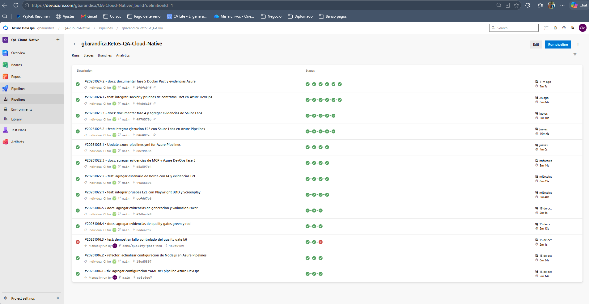
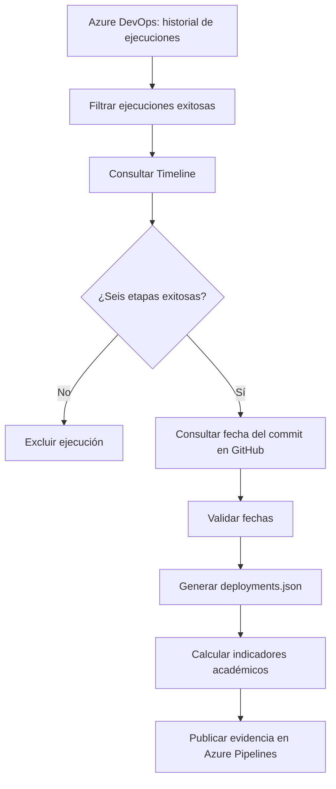
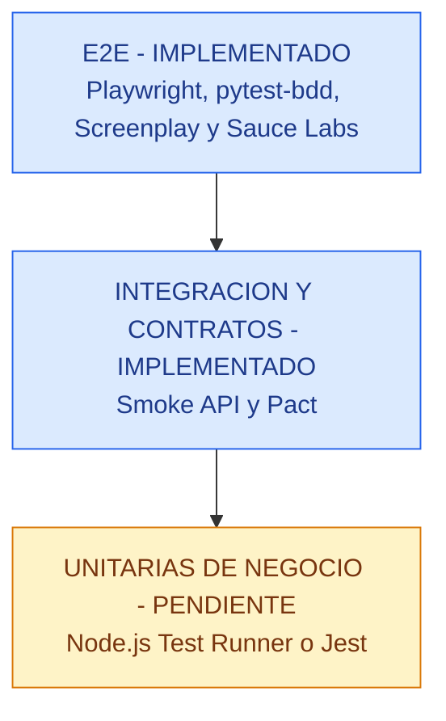
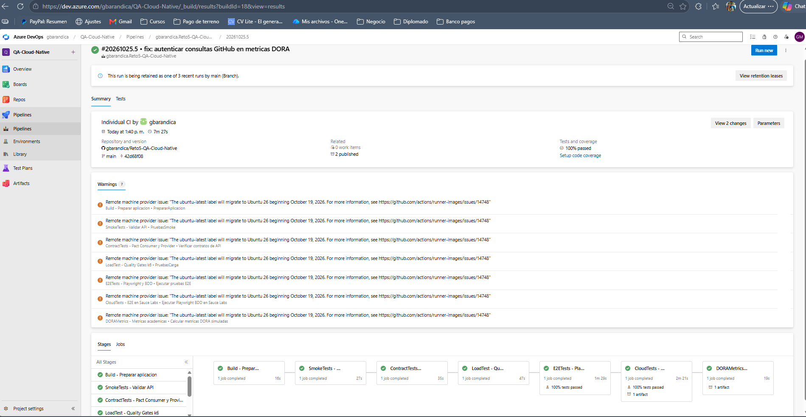

# Fase 6 – Métricas DORA y estrategia de calidad

**Proyecto:** Reto 5 – QA Cloud-Native
**Módulo:** Automatización Inteligente con IA Generativa
**Estado:** Implementación e integración validadas en Azure DevOps; métricas académicas simuladas generadas y publicadas
**Objetivo:** evaluar el desempeño del flujo CI/CD, representar la estrategia de pruebas, automatizar la obtención de indicadores académicos inspirados en DORA e identificar riesgos de calidad y sus mitigaciones.

---

## 1. Métricas DORA aplicadas al proyecto

### 1.1. Contexto de medición

El proyecto Tienda QA utiliza GitHub para el control de versiones y Azure DevOps para la integración continua.

El pipeline automatiza seis etapas principales de construcción y validación:

1. `Build`: preparación de la aplicación y construcción de la imagen Docker.
2. `SmokeTests`: validación de disponibilidad y funcionamiento básico.
3. `ContractTests`: pruebas de contratos API mediante Pact.
4. `LoadTest`: pruebas de rendimiento y Quality Gates con k6.
5. `E2ETests`: automatización funcional con Playwright, pytest-bdd y el patrón Screenplay.
6. `CloudTests`: ejecución remota de pruebas mediante Sauce Labs.

También se implementó Docker para contenerizar la aplicación y Azure Container Registry para almacenar su imagen.

Adicionalmente, durante la Fase 6 se incorporó una séptima etapa:

7. `DORAMetrics`: validación del módulo de métricas, consulta del historial de Azure DevOps, generación de datos académicos y cálculo de indicadores.

Esta etapa se ejecuta después de `CloudTests` y no reemplaza los controles de calidad existentes.

**Alcance:** actualmente el proyecto demuestra integración continua, validaciones automatizadas, contenerización y publicación de una imagen Docker. No incluye un despliegue productivo de la aplicación ni monitoreo de incidentes de producción.

Por lo tanto, es necesario distinguir entre:

- **Indicadores observados de CI:** datos obtenidos del historial de ejecuciones de Azure DevOps.
- **Métricas académicas simuladas:** indicadores calculados utilizando ejecuciones exitosas como eventos equivalentes a entregas.
- **Objetivos operativos propuestos:** valores deseados para una futura implementación con despliegues reales.

Una ejecución exitosa del pipeline no equivale necesariamente a un despliegue en producción.

### 1.2. Cuadro de métricas DORA

| Métrica | Valor propuesto | Clasificación | Justificación |
|---|---|---|---|
| Deployment Frequency (frecuencia de despliegue) | 1 despliegue semanal | Objetivo estimado | Se propone una liberación semanal de cambios validados, manteniendo entregas pequeñas y controladas. |
| Lead Time for Changes (tiempo de entrega de cambios) | Menos de 60 minutos | Objetivo estimado | La última ejecución histórica analizada duró 7 minutos y 7 segundos. Se contempla tiempo adicional para revisión, aprobación y despliegue. |
| Change Failure Rate (tasa de fallo de cambios) | Menor al 10 % | Objetivo estimado | Se busca minimizar incidentes mediante pruebas smoke, contratos Pact, rendimiento con k6 y escenarios E2E. |
| MTTR (tiempo medio de recuperación) | Menos de 30 minutos | Objetivo estimado | Se plantea una recuperación mediante monitoreo, diagnóstico y rollback a una versión estable de la imagen Docker. |

**Nota:** estos valores no representan métricas DORA medidas en producción. Son estimaciones razonadas y objetivos propuestos para una futura operación del sistema.

Los resultados generados por el módulo `DORAMetrics` se presentan por separado como métricas académicas de entregas simuladas.

### 1.2.1. Resultados de la ejecución integrada en Azure DevOps

La integración fue validada mediante la ejecución
[#20261025.3](https://dev.azure.com/gbarandica/QA-Cloud-Native/_build/results?buildId=16&view=results).

| Indicador | Resultado |
|---|---|
| Identificador de ejecución | `#20261025.3` |
| Build ID | `16` |
| Etapas aprobadas | 7 de 7 |
| Pruebas unitarias del módulo DORA | 14 aprobadas |
| Duración del pipeline | 7 minutos y 25 segundos |
| Artefacto publicado | `metricas-dora` |

**Métricas académicas calculadas:**

| Métrica | Resultado |
|---|---|
| Despliegues simulados | 2 |
| Ventana observada | 1 día |
| Deployment Frequency | 2 despliegues simulados/día |
| Lead Time for Changes | 0,13 horas |
| Change Failure Rate | 0 % simulado |
| MTTR | No calculable (sin incidentes registrados) |

**Interpretación:** las entregas se simulan a partir de ejecuciones
exitosas que superaron las seis etapas obligatorias. El resultado de
Change Failure Rate es 0 % porque los registros elegibles se generan
con `failed: false`; no demuestra ausencia de incidentes productivos.

El MTTR no puede calcularse porque no existen registros de incidentes
con fechas de recuperación. Los resultados no representan despliegues
reales a producción.

**Evidencias:**

- [03 - Pipeline con siete etapas exitosas](evidencias/fase-6/03_Ejecucion_Exitosa_Pipeline_DORA.png)
- [04 - Etapa DORAMetrics exitosa](evidencias/fase-6/04_Etapa_DORAMetrics_Exitosa.png)
- [05 - Artefacto DORA publicado](evidencias/fase-6/05_Artefacto_DORA_Publicado.png)
- [06 - Resultados de métricas DORA](evidencias/fase-6/06_Resultados_Metricas_DORA.png)
### 1.3. Indicadores históricos de Azure DevOps

Se analizó una muestra del historial visible de ejecuciones del pipeline, anterior a la incorporación de la etapa `DORAMetrics`.

| Indicador | Resultado observado |
|---|---|
| Ejecuciones registradas en la muestra | 13 |
| Ejecuciones exitosas | 12 |
| Ejecuciones fallidas | 1 |
| Tasa de éxito de CI | 92,3 % |
| Última ejecución analizada | `#20261024.2` |
| Duración de la última ejecución | 7 minutos y 7 segundos |
| Etapas completadas en la última ejecución | 6 de 6 |
| Ejecución fallida identificada | `#20261016.3` |
| Motivo de la ejecución fallida | Demostración controlada del Quality Gate de k6 |

**Cálculo de la tasa de éxito de CI:**

Tasa de éxito = (ejecuciones exitosas / ejecuciones totales) × 100

Tasa de éxito = (12 / 13) × 100 = **92,3 %**

La ejecución fallida fue provocada intencionalmente para comprobar que el Quality Gate bloqueara el proceso cuando no se cumplieran los criterios de rendimiento.

Esta tasa es un indicador complementario de integración continua y no debe confundirse con el Change Failure Rate de DORA, que requiere información sobre fallos asociados a despliegues reales.

Los valores anteriores corresponden a una muestra histórica y no deben interpretarse como resultados de la nueva etapa `DORAMetrics`.

### 1.4. Interpretación de las métricas

**Deployment Frequency – Frecuencia de despliegue**

Mide la frecuencia con la que se despliegan cambios a un entorno productivo.

La ejecución automática de un pipeline no equivale necesariamente a un despliegue.

En este proyecto se propone una frecuencia semanal como objetivo inicial para una futura operación.

El módulo académico utiliza ejecuciones exitosas que cumplen los seis controles obligatorios como eventos de entrega simulados.

**Lead Time for Changes – Tiempo de entrega de cambios**

Mide el tiempo transcurrido desde que un cambio queda registrado en el control de versiones hasta su despliegue.

La duración del pipeline constituye una parte del proceso, pero no representa el lead time completo.

En la simulación académica se utiliza la fecha del commit obtenida desde GitHub y la fecha de finalización de la ejecución elegible en Azure DevOps.

Este cálculo aproxima el tiempo entre el commit y una entrega simulada, pero no demuestra el tiempo real de llegada del cambio a producción.

**Change Failure Rate – Tasa de fallo de cambios**

Representa la proporción de despliegues que generan incidentes o requieren intervención correctiva.

El fallo controlado del Quality Gate de k6 no constituye un incidente productivo. Por el contrario, demuestra que el pipeline puede detectar condiciones no aceptables antes de liberar cambios.

Actualmente, el adaptador genera registros simulados con el campo `failed: false`.

Este campo forma parte del modelo de datos académico y no demuestra que la aplicación haya tenido una tasa real de incidentes del 0 %.

Por tanto, cualquier porcentaje calculado con esos registros debe identificarse como resultado de la simulación, no como Change Failure Rate productivo.

**MTTR – Tiempo medio de recuperación**

Mide cuánto tarda un sistema en recuperarse después de un fallo.

Para calcularlo se necesitan registros de incidentes, tiempos de inicio, acciones correctivas y confirmación de recuperación del servicio.

El proyecto no dispone de esos registros productivos.

Se propone un objetivo inferior a 30 minutos, condicionado a disponer de monitoreo, alertas y un procedimiento de rollback previamente validado.

Mientras no existan incidentes registrados con sus correspondientes tiempos de restauración, el MTTR productivo se considera **no calculable**.

### 1.5. Evidencia de medición histórica

**Evidencia 01 – Historial de ejecuciones de Azure DevOps**



La captura presenta el historial de ejecuciones del pipeline, incluyendo estados, commits y duraciones.

Se utiliza como respaldo de los indicadores observados de integración continua y de la muestra histórica analizada.

### 1.6. Conclusión del análisis DORA inicial

El proyecto cuenta con un proceso de integración continua que ejecuta automáticamente controles de calidad sobre los cambios publicados.

Las pruebas automatizadas, los contratos API, los Quality Gates y la contenerización proporcionan una base para implementar entrega continua en el futuro.

La principal oportunidad de mejora consiste en incorporar despliegues automatizados a un entorno controlado, monitoreo e identificación de incidentes.

Esto permitiría reemplazar las estimaciones DORA por mediciones reales y evaluar la evolución del desempeño del proceso de entrega.

### 1.7. Implementación del módulo de métricas DORA

Durante la Fase 6 se desarrolló un módulo en Node.js para automatizar la consulta, transformación y procesamiento de información procedente de Azure DevOps y GitHub.

El módulo separa dos responsabilidades:

- **Adquisición y validación de datos:** realizada por el adaptador de Azure DevOps.
- **Cálculo de indicadores:** realizada por la calculadora DORA.

Esta separación permite probar los componentes de forma independiente y facilita futuras modificaciones.

#### 1.7.1. Estructura del módulo

```text
metricas/
├── adaptadores/
│   └── azure-devops.js
├── tests/
│   ├── azure-devops.test.js
│   └── calcular-dora.test.js
├── calcular-dora.js
├── deployments.json
└── README.md
```

**Descripción de los componentes:**

| Archivo | Responsabilidad |
|---|---|
| `adaptadores/azure-devops.js` | Consulta ejecuciones, verifica etapas obligatorias y obtiene fechas de commits. |
| `calcular-dora.js` | Valida los datos y calcula los indicadores académicos. |
| `tests/azure-devops.test.js` | Contiene pruebas unitarias del adaptador y sus reglas de validación. |
| `tests/calcular-dora.test.js` | Contiene pruebas unitarias de las fórmulas y la consistencia de fechas. |
| `deployments.json` | Almacena temporalmente los registros generados durante la ejecución. |
| `README.md` | Documenta la arquitectura, ejecución y limitaciones del módulo. |

El archivo `deployments.json` se excluye del control de versiones mediante `.gitignore`, porque es un resultado generado automáticamente.

#### 1.7.2. Consulta del historial de Azure DevOps

La función `obtenerEjecuciones()` consulta la API REST de Azure DevOps para recuperar hasta 100 ejecuciones recientes del pipeline configurado.

Utiliza el token `SYSTEM_ACCESSTOKEN` proporcionado durante la ejecución en Azure Pipelines.

El adaptador comprueba que la respuesta sea válida antes de procesarla.

Posteriormente, `transformarEjecuciones()` selecciona las ejecuciones que cumplen las condiciones iniciales:

- Estado `completed`.
- Resultado `succeeded`.
- Fecha de finalización disponible.

Estas ejecuciones se consideran candidatas, pero todavía deben superar la validación del Timeline.

#### 1.7.3. Validación de las seis etapas obligatorias

Para cada ejecución candidata, `obtenerTimeline()` consulta los registros de ejecución de sus etapas.

La función `tieneEtapasObligatorias()` verifica que existan las siguientes etapas con estado `completed` y resultado `succeeded`:

1. `Build`
2. `SmokeTests`
3. `ContractTests`
4. `LoadTest`
5. `E2ETests`
6. `CloudTests`

Una ejecución que no incluya alguna de estas etapas, o que presente una etapa obligatoria fallida, se descarta.

Esta validación evita incorporar al análisis ejecuciones históricas que hayan terminado exitosamente cuando el pipeline todavía no tenía implementados todos los controles de calidad actuales.

**Principio aplicado:** una métrica confiable necesita datos correctos y criterios de elegibilidad explícitos.

#### 1.7.4. Obtención de fechas de GitHub

Después de validar las etapas, el adaptador consulta GitHub para recuperar la fecha del commit asociado a cada ejecución.

La función `obtenerFechaCommit()` utiliza el identificador SHA del commit.

La función `enriquecerDespliegues()` agrega el campo `committed_at` y comprueba que la fecha del commit no sea posterior a la fecha de finalización de la ejecución.

También utiliza una caché en memoria para evitar consultas repetidas cuando varias ejecuciones corresponden al mismo commit.

#### 1.7.5. Generación de `deployments.json`

El adaptador genera un archivo JSON con los registros elegibles.

Cada registro contiene información como:

- Identificador de ejecución.
- SHA del commit.
- Fecha del commit.
- Fecha de finalización de la ejecución.
- Origen de los datos.
- Identificador de simulación.
- Campo académico de fallo.

Ejemplo ilustrativo de estructura, no correspondiente a una ejecución real:

```json
{
  "id": "101",
  "commit": "0123456789abcdef0123456789abcdef01234567",
  "committed_at": "2026-10-24T11:00:00Z",
  "deployed_at": "2026-10-24T12:00:00Z",
  "simulated": true,
  "source": "azure-devops",
  "failed": false
}
```

El campo `simulated: true` permite identificar que el registro no corresponde a un despliegue productivo verificado.

#### 1.7.6. Cálculo de indicadores

La calculadora `calcular-dora.js` procesa los registros del archivo JSON.

Las operaciones principales son:

**Frecuencia de entregas simuladas**

Relaciona la cantidad de registros elegibles con la ventana de observación utilizada por la calculadora.

**Tiempo promedio de entrega simulada**

Calcula la diferencia entre `committed_at` y `deployed_at` para cada registro y obtiene el promedio.

**Tasa de fallos**

Calcula matemáticamente la proporción de registros marcados como fallidos.

Dado que el adaptador actual genera registros con `failed: false`, este resultado no debe presentarse como una medición productiva de Change Failure Rate.

**Tiempo medio de recuperación**

Se calcula únicamente cuando existen incidentes registrados con fechas válidas de fallo y restauración.

Si no hay incidentes, la calculadora devuelve un resultado no disponible para MTTR.

#### 1.7.7. Flujo completo



### 1.8. Integración en Azure Pipelines

Se agregó una séptima etapa denominada `DORAMetrics` al archivo `azure-pipelines.yml`.

Esta etapa depende de `CloudTests` y utiliza la condición `succeeded()`.

Su finalidad es generar indicadores académicos después de que las etapas principales del pipeline hayan finalizado correctamente.

#### 1.8.1. Actividades configuradas

La etapa ejecuta las siguientes actividades:

1. Configurar Node.js 24.
2. Ejecutar las pruebas unitarias del adaptador y la calculadora.
3. Consultar el historial de Azure DevOps.
4. Validar los Timelines de las ejecuciones candidatas.
5. Obtener las fechas de los commits desde GitHub.
6. Generar `deployments.json`.
7. Calcular los indicadores académicos.
8. Publicar el archivo JSON como artefacto `metricas-dora`.

#### 1.8.2. Autenticación

La consulta de Azure DevOps utiliza la variable `SYSTEM_ACCESSTOKEN`.

Esta variable se entrega al proceso mediante la configuración `env` del paso correspondiente.

La ejecución `#20261025.3` confirmó que la identidad del pipeline dispone de los permisos necesarios para consultar el historial de ejecuciones y sus Timelines.

No se almacenan tokens de acceso directamente en el código fuente.

#### 1.8.3. Comportamiento ante errores

El adaptador detiene su ejecución si no puede obtener o validar los datos necesarios.

También termina con error si no encuentra ejecuciones que cumplan las seis etapas obligatorias.

La consulta de datos y el cálculo de métricas se ejecutan en pasos separados, evitando que una consulta fallida quede oculta por la ejecución posterior de la calculadora.

Actualmente, un fallo de la etapa `DORAMetrics` puede afectar el resultado general del pipeline.

Para un entorno productivo se recomienda evaluar una política que separe los errores de observabilidad de los Quality Gates que determinan si una aplicación puede liberarse.

#### 1.8.4. Estado de integración

La etapa `DORAMetrics` fue integrada y validada exitosamente en Azure DevOps.

**Ejecución validada:** `#20261025.3` (Build ID `16`).

**Resultados obtenidos:**

- Siete etapas del pipeline completadas satisfactoriamente.
- Catorce pruebas unitarias del módulo DORA aprobadas.
- Consulta del historial de Azure DevOps ejecutada correctamente.
- Validación de las seis etapas obligatorias mediante los registros Timeline.
- Obtención de fechas de commits desde GitHub.
- Generación de `metricas/deployments.json`.
- Cálculo de los cuatro indicadores académicos.
- Publicación exitosa del artefacto `metricas-dora`.

Durante la integración se detectó que Azure DevOps devuelve los nombres
descriptivos (`displayName`) de las etapas en los registros Timeline.
El adaptador inicialmente esperaba los identificadores cortos definidos
en YAML, por lo que descartaba ejecuciones que sí cumplían los controles.

Se corrigió la correspondencia entre los identificadores y los nombres
descriptivos de las seis etapas obligatorias. Posteriormente se
validaron los casos positivos y negativos mediante pruebas unitarias
y se confirmó el funcionamiento en una nueva ejecución del pipeline.

**Resultado:** integración funcional y evidenciada. Los indicadores
generados siguen siendo simulaciones académicas y no métricas de
despliegues productivos.
### 1.9. Pruebas automatizadas del módulo DORA

Se implementaron 14 pruebas unitarias utilizando el sistema de pruebas nativo de Node.js.

Estas pruebas permiten validar el comportamiento de los componentes sin depender de conexiones reales con Azure DevOps o GitHub.

#### 1.9.1. Pruebas del adaptador

Se implementaron 10 pruebas que verifican:

1. Inclusión de ejecuciones exitosas como entregas simuladas.
2. Exclusión de ejecuciones fallidas.
3. Exclusión de ejecuciones en progreso.
4. Incorporación de la fecha del commit.
5. Reutilización de consultas para commits repetidos.
6. Rechazo de fechas de commit posteriores a la ejecución.
7. Propagación de errores de consulta.
8. Aceptación de ejecuciones con seis etapas exitosas.
9. Rechazo de ejecuciones con etapas obligatorias faltantes.
10. Rechazo de ejecuciones con etapas obligatorias fallidas.

#### 1.9.2. Pruebas de la calculadora

Se implementaron cuatro pruebas que verifican:

1. Cálculo de frecuencia, lead time y tasa de fallos con datos conocidos.
2. Ausencia de cálculo MTTR cuando no existen incidentes.
3. Rechazo de fechas de entrega anteriores al commit.
4. Rechazo de incidentes con fechas inconsistentes.

#### 1.9.3. Ejecución y resultados

Comando utilizado desde la raíz del proyecto:

```powershell
node --test .\metricas\tests\*.test.js
```

**Último resultado local registrado:**

| Indicador | Resultado |
|---|---|
| Pruebas ejecutadas | 14 |
| Pruebas aprobadas | 14 |
| Pruebas fallidas | 0 |
| Pruebas omitidas | 0 |
| Duración total | 473 ms aproximadamente |

Estos resultados demuestran que los escenarios unitarios implementados funcionan con los datos de prueba utilizados.

Las pruebas unitarias no validan por sí solas las consultas HTTP reales. Sin embargo, la ejecución integrada `#20261025.3` confirmó el funcionamiento del adaptador con Azure DevOps y GitHub.

#### 1.9.4. Buenas prácticas aplicadas

- Separación entre adquisición de datos y cálculo de indicadores.
- Validaciones positivas y negativas.
- Pruebas deterministas con datos simulados.
- Manejo explícito de errores.
- Validación de consistencia temporal.
- Caché para evitar consultas repetidas.
- Exclusión de archivos generados del repositorio.
- Publicación de evidencias mediante artefactos.
- Identificación explícita de las entregas simuladas.

### 1.10. Limitaciones y mejoras futuras

La implementación académica presenta las siguientes limitaciones:

- No registra despliegues productivos reales.
- No dispone de eventos de incidentes de producción.
- El campo `failed: false` no demuestra ausencia de fallos productivos.
- La frecuencia y el lead time calculados representan aproximaciones académicas.
- La consulta del historial está limitada a las 100 ejecuciones recientes solicitadas.
- Las consultas dependen de la disponibilidad de Azure DevOps y GitHub.
- La ejecución actual puede no estar finalizada cuando la etapa DORA consulta el historial.
- Las pruebas unitarias no sustituyen una prueba de integración real con las APIs externas.

Como evolución futura, se recomienda:

1. Incorporar despliegues reales a un entorno controlado.
2. Registrar eventos de despliegue con identificadores de versión y commits asociados.
3. Integrar monitoreo y gestión de incidentes.
4. Registrar tiempos de fallo y recuperación.
5. Establecer una ventana de observación explícita para los indicadores.
6. Separar las métricas operativas de los controles que bloquean liberaciones.
7. Incorporar pruebas de integración del adaptador con respuestas HTTP simuladas y escenarios de error.
8. Generar reportes históricos para analizar tendencias.

---

## 2. Pirámide de pruebas y estrategia de automatización

### 2.1. Objetivo

La pirámide de pruebas permite organizar las validaciones automatizadas según su alcance, velocidad de ejecución, costo de mantenimiento y capacidad de detección de defectos.

La estrategia recomendada prioriza pruebas unitarias rápidas, complementadas con pruebas de integración y un conjunto seleccionado de pruebas end-to-end (E2E).

En Tienda QA se implementaron pruebas de API, contratos, rendimiento y flujos E2E.

Durante la Fase 6 se incorporaron 14 pruebas unitarias del módulo de métricas DORA. Sin embargo, todavía no existe una suite dedicada de pruebas unitarias para la lógica de negocio de Tienda QA.

Esta distinción es importante: las pruebas unitarias del módulo DORA validan componentes de la infraestructura de automatización, pero no sustituyen las pruebas unitarias de la aplicación.

### 2.2. Distribución de herramientas

| Nivel o categoría | Herramientas | Estado | Justificación |
|---|---|---|---|
| Unitarias del módulo DORA | Node.js Test Runner | Implementado | Valida el adaptador, las reglas de elegibilidad y la calculadora mediante 14 pruebas. |
| Unitarias de negocio | Node.js Test Runner o Jest | Pendiente | Permitiría validar funciones y reglas de negocio de Tienda QA de forma aislada. |
| Integración / API | Pruebas smoke con Node.js y solicitudes HTTP | Implementado | Verifican disponibilidad y comportamiento básico de los endpoints. |
| Contratos entre componentes | Pact | Implementado | Valida que el proveedor API cumpla las expectativas del consumidor. |
| E2E | Playwright, Python, pytest-bdd y Screenplay | Implementado | Comprueba flujos funcionales completos desde la interfaz. |
| E2E remoto | Sauce Labs y Sauce Connect | Implementado | Permite ejecutar escenarios en infraestructura de navegadores remotos. |
| Rendimiento | k6 | Implementado | Evalúa tiempos de respuesta y errores bajo carga mediante Quality Gates. |
| Infraestructura | Docker y Azure Container Registry | Implementado | Facilitan la ejecución reproducible y distribución de la aplicación contenerizada. |
| Orquestación CI/CD | Azure DevOps | Implementado | Automatiza las validaciones y coordina las etapas del pipeline. |
| Observabilidad de CI | Módulo DORA en Node.js | Integrado y validado en Azure DevOps | Procesa el historial del pipeline y calcula indicadores académicos. |

**Aclaración:** k6, Docker, Azure Container Registry, Azure DevOps y el módulo DORA no constituyen niveles de la pirámide de pruebas funcionales. Son herramientas complementarias de rendimiento, infraestructura, orquestación y observabilidad.

### 2.3. Justificación por nivel

**Pruebas unitarias – Base de la pirámide**

Se recomienda incorporar pruebas unitarias para funciones de negocio como validaciones de productos, cálculos de totales y reglas de pedidos.

Estas pruebas permitirían detectar defectos tempranamente, sin depender del navegador ni de servicios externos.

Actualmente existe una suite de 14 pruebas unitarias del módulo DORA, pero no una suite dedicada a las reglas de negocio de Tienda QA.

Por ello, fortalecer las pruebas unitarias de negocio continúa siendo una oportunidad de mejora.

**Pruebas de integración y API – Nivel intermedio**

Las pruebas smoke verifican que los servicios principales respondan correctamente.

Pact complementa estas validaciones mediante contratos entre el frontend y la API.

Se implementaron interacciones para `GET /api/productos` y `GET /api/productos/1`.

Las pruebas de contrato permiten detectar cambios incompatibles en las interfaces, aunque no sustituyen las pruebas de integración completas.

**Pruebas E2E – Parte superior de la pirámide**

Playwright permite interactuar con la interfaz de Tienda QA y verificar comportamientos desde la perspectiva del usuario.

pytest-bdd facilita la descripción de escenarios mediante Gherkin, mientras que Screenplay organiza las interacciones y responsabilidades del framework.

Los cinco escenarios funcionales cubren la visualización del catálogo, búsquedas, carrito de compras y confirmación de pedidos.

Sauce Labs permite ejecutar estos escenarios en un navegador remoto, complementando la ejecución en el agente CI.

### 2.4. Herramientas transversales

**k6:** permite validar atributos de calidad no funcionales, especialmente tiempos de respuesta y tasas de error. Sus thresholds funcionan como Quality Gates.

**Docker:** proporciona un entorno reproducible para ejecutar la aplicación.

**Azure Container Registry:** almacena la imagen Docker versionada.

**Azure DevOps:** ejecuta y coordina las etapas de construcción, smoke, contratos, rendimiento y pruebas E2E.

**Módulo DORA:** consulta el historial del pipeline, valida ejecuciones elegibles y calcula indicadores académicos de entrega.

Estas herramientas respaldan la estrategia general de calidad, pero no deben clasificarse artificialmente como pruebas unitarias, de integración o E2E.

### 2.5. Evaluación de la estrategia actual

**Fortalezas:**

- Validaciones automatizadas en diferentes niveles.
- Contratos API integrados al pipeline.
- Escenarios funcionales BDD reutilizables.
- Pruebas E2E locales y remotas.
- Quality Gates de rendimiento.
- Ejecución reproducible mediante Docker.
- Pruebas unitarias del módulo DORA.
- Validación de elegibilidad de ejecuciones históricas.
- Generación automatizada de datos para indicadores académicos.
- Separación entre componentes de consulta y cálculo.

**Oportunidades de mejora:**

- Incorporar una suite de pruebas unitarias de negocio.
- Ampliar las pruebas de integración de la aplicación.
- Incorporar pruebas de integración del adaptador DORA.
- Implementar despliegues controlados y monitoreo.
- Registrar incidentes y tiempos de recuperación.
- Evaluar la distribución de pruebas según costo, velocidad y riesgo.

**Conclusión:** la estrategia actual proporciona cobertura funcional, contractual y de rendimiento, complementada por pruebas unitarias de la infraestructura de métricas.

Sin embargo, la automatización de la aplicación sigue orientada principalmente a integración y E2E.

Se recomienda fortalecer progresivamente las pruebas unitarias de negocio para mejorar el equilibrio de la pirámide y reducir el costo de detección de defectos.

### 2.6. Diagrama de la pirámide de pruebas



**Nota:** el diagrama representa los niveles de pruebas de la aplicación Tienda QA. Las 14 pruebas unitarias del módulo DORA pertenecen a la infraestructura de automatización y no modifican el estado pendiente de las pruebas unitarias de negocio.

k6, Docker, Azure DevOps y el módulo DORA son herramientas transversales y no pertenecen a un nivel específico de la pirámide funcional.

---

## 3. Riesgos de calidad y estrategias de mitigación

### 3.1. Objetivo

Identificar los principales riesgos técnicos y operativos del proyecto, considerando la arquitectura de automatización, las dependencias externas y la confiabilidad del pipeline.

### 3.2. Matriz de riesgos

| Riesgo | Impacto potencial | Estrategia de mitigación |
|---|---|---|
| Cambios incompatibles en contratos API | Fallos entre consumidor y proveedor | Ejecutar pruebas Pact antes de las pruebas E2E. |
| Degradación del rendimiento | Aumento de tiempos de respuesta y errores | Aplicar thresholds de k6 como Quality Gates. |
| Pruebas E2E inestables | Falsos negativos y pérdida de confianza | Utilizar localizadores robustos, esperas explícitas y responsabilidades separadas. |
| Fallos de infraestructura remota | Interrupción de pruebas en Sauce Labs | Revisar conectividad, configuración de Sauce Connect y evidencias de ejecución. |
| Cambios no validados | Introducción de defectos | Mantener la secuencia de validaciones del pipeline. |
| Falta de pruebas unitarias de negocio | Detección tardía de defectos | Incorporar pruebas aisladas de reglas y cálculos de la aplicación. |
| Datos históricos incompletos | Indicadores académicos incorrectos | Verificar las seis etapas obligatorias antes de incluir ejecuciones. |
| Indisponibilidad de Azure DevOps o GitHub | Imposibilidad de generar métricas | Manejar errores explícitamente y evitar resultados parciales. |
| Interpretación incorrecta de métricas DORA | Conclusiones engañosas sobre desempeño productivo | Identificar los resultados como simulados y separar objetivos de mediciones. |
| Ausencia de registros de incidentes | Imposibilidad de calcular CFR y MTTR productivos | Incorporar monitoreo y gestión de incidentes en una futura etapa. |
| Fallo de la etapa de observabilidad | Resultado general fallido pese a superar controles de aplicación | Evaluar una política independiente para las métricas. |

### 3.3. Priorización

Las principales prioridades de mejora son:

1. Fortalecer las pruebas unitarias de negocio.
2. Mantener estables los Quality Gates existentes.
3. Validar la integración real del módulo DORA con Azure DevOps.
4. Evitar presentar métricas simuladas como resultados productivos.
5. Incorporar monitoreo e incidentes cuando existan despliegues reales.

---

## 4. Conclusiones generales

La Fase 6 se completó mediante la implementación y validación de un módulo de métricas DORA académicas integrado en Azure DevOps.

El pipeline cuenta con siete etapas automatizadas: `Build`, `SmokeTests`, `ContractTests`, `LoadTest`, `E2ETests`, `CloudTests` y `DORAMetrics`.

La ejecución `#20261025.3` (Build ID `16`) confirmó el funcionamiento de las siete etapas, la aprobación de las 14 pruebas unitarias del módulo DORA y la publicación del artefacto `metricas-dora`.

Los resultados académicos obtenidos fueron:

- **Deployment Frequency:** 2 entregas simuladas por día.
- **Lead Time for Changes:** 0,13 horas.
- **Change Failure Rate:** 0 % simulado.
- **MTTR:** no calculable por ausencia de incidentes registrados.

Estos indicadores no representan despliegues reales a producción. En particular, el 0 % de Change Failure Rate resulta del modelo académico, que utiliza registros elegibles marcados como no fallidos.

La estrategia de calidad combina pruebas smoke de API, contratos Pact, pruebas de rendimiento k6, escenarios E2E con Playwright y pytest-bdd, ejecución remota en Sauce Labs y pruebas unitarias del módulo de métricas.

Como oportunidad de mejora se mantiene la incorporación de pruebas unitarias para la lógica de negocio de Tienda QA, así como la implementación futura de despliegues controlados, monitoreo e incidentes productivos.

La experiencia también permitió identificar y corregir una incompatibilidad entre los identificadores de etapas definidos en YAML y los nombres descriptivos devueltos por la API Timeline de Azure DevOps.

**Conclusión:** se completó la integración de métricas académicas al pipeline CI/CD, conservando los controles de calidad existentes y documentando explícitamente las limitaciones de los indicadores.

---

## 5. Estado de validación y próximos pasos

| Actividad | Estado |
|---|---|
| Análisis histórico de ejecuciones de CI | Completado |
| Evidencia del historial de Azure DevOps | Disponible |
| Diseño del módulo DORA | Completado |
| Implementación del adaptador | Completado |
| Validación de las seis etapas obligatorias | Completada |
| Corrección de nombres `displayName` en Timeline | Completada |
| Implementación de la calculadora | Completada |
| Ejecución de 14 pruebas unitarias | Aprobada |
| Integración de `DORAMetrics` en Azure Pipelines | Validada |
| Ejecución de siete etapas del pipeline | Exitosa |
| Generación de `metricas/deployments.json` | Validada |
| Publicación del artefacto `metricas-dora` | Exitosa |
| Incorporación de resultados al informe | Completada |
| Evidencias de la ejecución integrada | Disponibles |

**Ejecución final validada:** [#20261025.3](https://dev.azure.com/gbarandica/QA-Cloud-Native/_build/results?buildId=16&view=results).

**Duración total:** 7 minutos y 25 segundos.

**Próximas mejoras recomendadas:**

1. Incorporar pruebas unitarias de las reglas de negocio de Tienda QA.
2. Implementar despliegues reales en un entorno controlado.
3. Integrar monitoreo y registro de incidentes.
4. Calcular métricas DORA productivas a partir de eventos reales de despliegue y recuperación.
5. Analizar tendencias históricas mediante reportes periódicos.

## Validación final y resolución de incidencia CI/CD

Durante la validación final de la Fase 6 se identificó una incidencia en la integración entre Azure DevOps y GitHub.

### Incidencia detectada

En el Build 17, la etapa `DORAMetrics` identificó correctamente las ejecuciones elegibles del pipeline, pero falló al consultar la fecha de un commit mediante la API de GitHub, que respondió con HTTP 403.

El diagnóstico confirmó que las solicitudes a GitHub se realizaban sin autenticación. Se identificó como causa probable una restricción de acceso o límite de solicitudes aplicado al agente de Azure DevOps.

### Solución implementada

Se actualizó el adaptador `metricas/adaptadores/azure-devops.js` para permitir autenticación mediante la variable de entorno `GITHUB_TOKEN` y mejorar el diagnóstico de errores HTTP.

Se creó un token de GitHub con permisos mínimos de lectura sobre el repositorio y se configuró como variable secreta en Azure DevOps. Asimismo, se actualizó `azure-pipelines.yml` para proporcionar esta variable exclusivamente a la tarea encargada de consultar el historial de commits.

La corrección se registró en el commit `42d68f0`.

### Validación de la solución

Se ejecutaron satisfactoriamente las 14 pruebas unitarias del módulo DORA.

Posteriormente, Azure DevOps ejecutó el pipeline **#20261025.5 (Build 18)**, obteniendo los siguientes resultados:

- Siete etapas completadas exitosamente.
- Duración total: 7 minutos y 27 segundos.
- Pruebas publicadas: 100 % aprobadas.
- Etapa `DORAMetrics` finalizada correctamente.
- Artefacto de métricas DORA publicado.

**Evidencia final:**



[Consultar ejecución final en Azure DevOps](https://dev.azure.com/gbarandica/QA-Cloud-Native/_build/results?buildId=18&view=results)

### Conclusión

La incidencia permitió validar el proceso de diagnóstico y resolución de errores de integración en CI/CD, incorporando autenticación segura, gestión de secretos y verificación mediante pruebas automatizadas.

Con la ejecución exitosa del Build 18, se confirma el funcionamiento integral del pipeline de siete etapas y la publicación del artefacto DORA.

Las métricas DORA obtenidas corresponden a una simulación académica y no representan despliegues reales en producción.